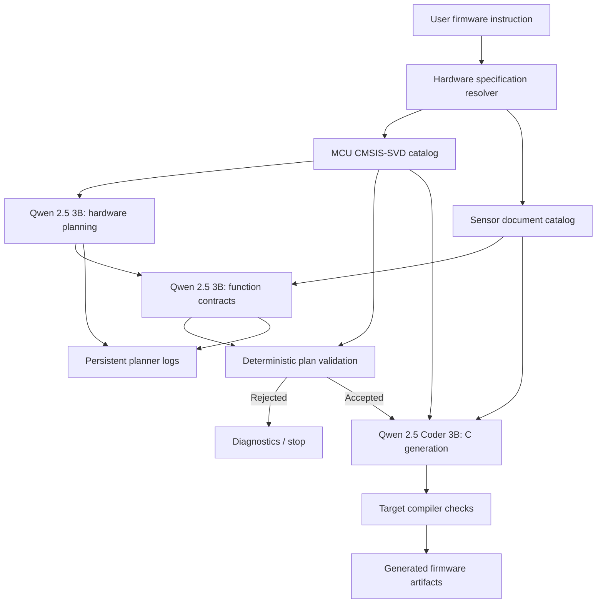

# Silicon-Compiler AI

**A hardware-grounded, local AI agent for embedded firmware generation.**

  

Silicon-Compiler AI explores whether small language models, combined with structured hardware specifications and deterministic validation, can generate reliable register-level embedded C without relying on large cloud-hosted models.

Rather than asking an LLM to invent an entire firmware implementation, the system separates hardware discovery, planning, validation, code generation and compilation.

> **Project status:** Early research prototype. Hardware discovery and planner streaming are implemented. Reliable end-to-end firmware generation and on-target validation are still in progress. Generated code must not be treated as production-ready.

## Architecture



| Component | Responsibility |
| --- | --- |
| Specification resolver | Discover and cache MCU SVDs and sensor documentation |
| SVD extractor | Build structured peripheral, register and field catalogs |
| Sensor extractor | Preserve source text, macros and provenance; retrieve relevant excerpts |
| Planner | Select peripherals and produce dependency-aware function contracts in two passes |
| Plan validator | Check hardware references, dependencies and required evidence before generation |
| Code generator | Generate C functions using validated plans and hardware context |
| Toolchain resolver | Select target-specific compiler and flags |
| Web UI | Stream progress, model output and validation diagnostics |

## Models

| Model | Role |
| --- | --- |
| `qwen2.5:3b` | Hardware planning and task decomposition |
| `qwen2.5-coder:3b` | Embedded C generation |

Inference runs locally through Ollama. Hardware-document discovery may require internet access; the project is not fully offline during initial setup.

## Current progress

- [x] Dynamic MCU SVD discovery and structured extraction
- [x] Sensor header discovery, source manifests and document catalogs
- [x] Two-pass hardware planner with structured JSON contracts
- [x] Deterministic hardware-plan validation and fail-closed generation gate
- [x] Code-generation and target compiler-check pipeline implemented
- [x] FastAPI backend and browser UI with streaming model activity
- [x] Incremental planner output logging, including separate files for retries
- [ ] Consistently valid planner contracts on small models
- [ ] Complete, manufacturer-grounded sensor protocol and pin-mapping evidence
- [ ] Reproducible end-to-end compilation and physical hardware verification

### Current development case: STM32F411 + BH1750

Example instruction:

```text
Configure BH1750 on STM32F411 over I2C1 in continuous high-resolution mode,
wait for conversion, and read the light intensity in lux.
```

The hardware-selection pass has produced `I2C1`, `RCC` and `GPIOB`, with clock-before-bus ordering and an explicit requirement to verify board pin mapping. The contract-generation pass is still being debugged: an observed partial response contains register references in the wrong schema and inconsistent initialization preconditions. The available log does not establish why generation stopped.

The sensor catalog currently contains four third-party BH1750 headers, not a verified manufacturer PDF. Header retrieval is macro-oriented and can omit enums, comments and timing details. These are known limitations, not evidence of a successful firmware run.

## Repository layout

```text
silicon-compiler-ai/
├── main.py                 # FastAPI backend
├── Task_decomposer.py      # Two-pass planner and persistent logs
├── plan_validator.py       # Deterministic plan checks
├── code_generator.py       # C generation and compiler checks
├── datasheet_fetcher.py    # MCU SVD discovery
├── svd_extractor.py        # Structured MCU register catalog
├── sensor_fetcher.py       # Sensor source discovery
├── sensor_extractor.py     # Sensor catalog and retrieval
├── toolchain_resolver.py   # Compiler selection
├── ui/
│   └── index.html          # Browser interface
├── requirements.txt
└── README.md
```

Runtime directories (`hardware_specs/`, `sensor_specs/`, `sessions/`, `output/`, `planner_logs/`) are local and excluded from version control by default.

## Getting started (Windows)

Install Python 3.10 or newer, Git, [Ollama](https://ollama.com/) and the appropriate embedded compiler. For STM32, install Arm GNU Toolchain and make `arm-none-eabi-gcc` available on PATH.

From the repository directory in PowerShell:

```powershell
python -m venv venv
.\venv\Scripts\Activate.ps1
python -m pip install -r requirements.txt
ollama pull qwen2.5:3b
ollama pull qwen2.5-coder:3b
```

Ensure Ollama is running (start `ollama serve` in a separate terminal if necessary). Then:

```powershell
python -m uvicorn main:app --host 127.0.0.1 --port 8000
```

Open http://127.0.0.1:8000, configure the target MCU and sensor, and submit a firmware instruction. Plans requiring missing hardware evidence may be rejected intentionally.

### Debugging planner output

The planner writes received response fragments incrementally to `planner_logs/`. Partial output is retained after ordinary process interruption, and each attempt has its own raw output and JSONL event log. Partial files need not be valid JSON.

```powershell
Get-Content (Get-ChildItem .\planner_logs\*.partial.txt |
    Sort-Object LastWriteTime -Descending |
    Select-Object -First 1).FullName -Wait
```

The planner supports `PLANNER_NUM_CTX` and `PLANNER_NUM_PREDICT` environment variables. The default prediction setting is `-1` (no explicit prediction-token cap); context and available memory still impose practical limits.

## Roadmap

| Phase | Next engineering milestone |
| --- | --- |
| 1 — Observability | Persist exact model prompts, retrieved context, validation failures and generation metrics |
| 2 — Sensor grounding | Prefer manufacturer documentation; preserve complete small headers, enums and comments; deduplicate and track provenance |
| 3 — Planner reliability | Compact task-specific register inventories, enforce structured JSON schemas, validate each contract and target retries at failed constraints |
| 4 — Hardware evidence | Resolve pin multiplexing, board wiring, clock configuration and protocol timing from verified sources |
| 5 — Code reliability | Improve task-wise generation, compiler-guided repair, integration and tests |
| 6 — Hardware validation | Run STM32F411/BH1750 firmware on physical hardware and compare readings against a reference implementation |
| 7 — Generalization | Extend the evaluation to additional sensors, buses and MCU families with target-specific toolchains |

## Research direction

The central question is whether deterministic hardware grounding can compensate for the limitations of small local models. Planned evaluation metrics include plan acceptance rate, invalid register-reference rate, compilation success, on-target functional correctness, inference latency and resource usage. Comparisons against ungrounded generation and single-model baselines are planned, not completed.

## Limitations and safety

CMSIS-SVD describes registers but does not by itself establish board wiring, complete pin multiplexing or peripheral initialization sequences. Third-party sensor headers are not manufacturer verification. Successful compilation does not establish electrical safety or runtime correctness. Review generated firmware and test it on suitable hardware before deployment.

## Third-party material

Downloaded hardware specifications and sensor headers retain their original ownership and license terms. Review redistribution permissions before committing them. This repository does not claim ownership of third-party models or documentation. A project license should be selected before inviting redistribution or external contributions.
